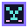
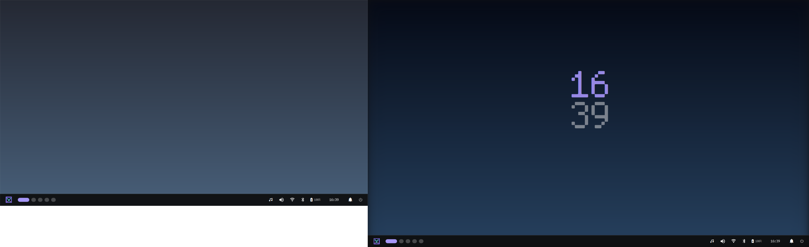
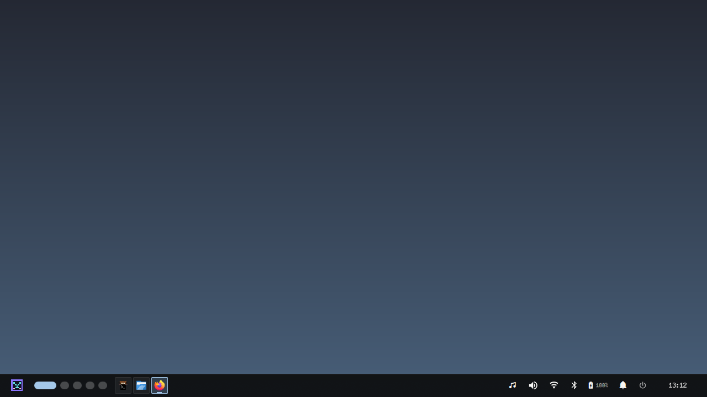
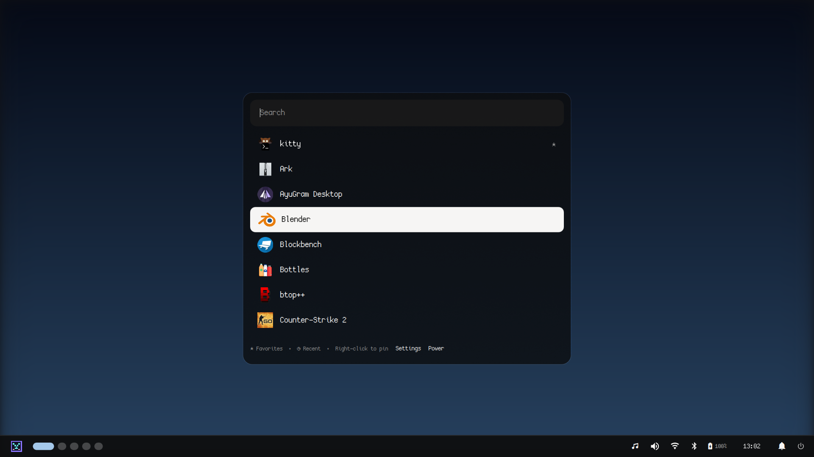
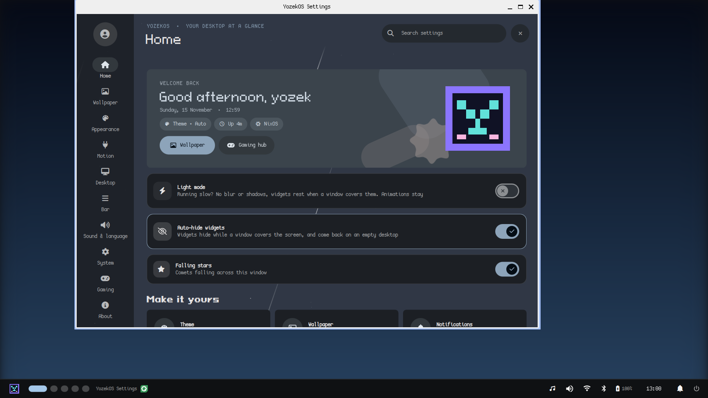

<div align="center">
  

# YozekOS

**Пиксельный характер. Современный рабочий стол.**

Графическая среда для NixOS на базе Niri и Quickshell.

[](docs/installation.md)
[](https://github.com/YaLTeR/niri)
[](https://quickshell.outfoxxed.me/)
[](THIRD-PARTY.md)

[Установить](docs/installation.md) · [Документация](docs/architecture.md) · [Исходный код](https://github.com/Yozekkk/YozekOS)
</div>



*Текущая панель с отдельными кнопками окон:*



<details><summary>Ещё снимки интерфейса</summary>

| Меню приложений | Настройки |
| --- | --- |
|  |  |


</details>

## Что такое YozekOS

YozekOS — настраиваемая графическая среда автора [Yozekkk](https://github.com/Yozekkk), а не отдельный дистрибутив Linux. Niri управляет окнами и рабочими пространствами; Quickshell рисует панель, меню, уведомления и виджеты. Параметры хранятся в обычных файлах, а пользовательская часть устанавливается без изменения системной конфигурации.

Проект вырос из [DarkShadowShell](https://github.com/shadowww-dev/DarkShadowShell) и использует элементы [angelOS](https://github.com/MixaDoDs/AngelOS-Dotfiles): сведения об авторах и лицензиях сохранены в [THIRD-PARTY.md](THIRD-PARTY.md).

## Возможности

| Компонент | Что доступно |
| --- | --- |
| Панель | Значок «Пуск», кнопки окон Niri, рабочие пространства, системный трей, звук, сеть, Bluetooth, часы и питание. Положение и состав панели меняются в настройках. |
| Dynamic Island | Отдельный модуль панели с часами и контекстными состояниями. Переключатель в настройках действительно добавляет или убирает его; по умолчанию он выключен, как в текущем рабочем профиле. |
| Меню и настройки | Поиск приложений, темы, обои, шрифты, значок «Пуск», панель, эффекты, правила окон и пользовательские команды. |
| Уведомления и управление | Центр уведомлений, управление звуком, яркостью, сетью, Bluetooth и медиа. Наличие функций зависит от служб и устройств NixOS. |
| Скриншоты | Выбор области, сохранение, буфер обмена и предпросмотр; редактирование открывается в Satty. Запись экрана поддерживается отдельным скриптом. |
| Пространства | Встроенный обзор Niri на **Super+O** и **Super+Tab**, переключение и перемещение окон клавишами. |
| Оформление | Пиксельные шрифты, темы, курсоры, цвета, обои, тени и анимации. |

## Быстрый старт на NixOS

```bash
git clone https://github.com/Yozekkk/YozekOS.git
cd YozekOS
./install.sh --dry-run
./install.sh
```

Установщик покажет изменения и запросит подтверждение при конфликте с существующими файлами. Он сохраняет копии в `~/.local/state/yozekos/installer/backups/`. Для системных пакетов подключите [модуль NixOS](docs/installation.md); установщик не меняет `/etc/nixos` и не выполняет `nixos-rebuild`.

После установки войдите в сеанс Niri и запустите `systemctl --user start yozekos-shell.service`. Для проверки: `yozekos doctor`. Подробности, зависимости, Home Manager и удаление — в [инструкции по установке](docs/installation.md).

## Настройка

Откройте **Super+U** или выполните `yozekos settings`. В окне доступны темы, панель, Dynamic Island, значок «Пуск», обои, виджеты, эффекты и параметры Niri. Личные параметры находятся в `~/.config/yozekos/`, а горячие клавиши — в `~/.config/niri/config.kdl`. [Руководство по настройке →](docs/configuration.md)

## Основные клавиши

| Сочетание | Действие |
| --- | --- |
| Super+R / Super+Space | Меню приложений |
| Super+U | Настройки YozekOS |
| Super+O / Super+Tab | Обзор рабочих пространств Niri |
| Super+1…9 | Перейти в рабочее пространство |
| Super+E | Файловый менеджер |
| Super+Q | Терминал Kitty |
| Super+N | Уведомления |
| Super+W | Обои |
| Print / Super+Shift+S | Выбрать область для снимка |
| Super+Shift+R | Запись области экрана |

[Полная таблица клавиш →](docs/keybindings.md)

## Состав проекта

```text
nix/                         модуль NixOS и пакеты
scripts/                     пользовательский установщик и коллекции обоев
yozekos/config/niri/         переносимый снимок активной конфигурации Niri
yozekos/defaults/             исходные параметры панели, виджетов и темы
yozekos/quickshell/          QML оболочки, настроек и экранов
yozekos/bin/                 команды панели, оформления, записи и диагностики
yozekos/capture/             выбор области и предпросмотр снимков
yozekos/sddm/                необязательная тема входа
yozekos/sounds/              звуки интерфейса
fonts/                       шрифты и лицензии
docs/                        руководство и снимки экрана
```

Архитектура и точки входа описаны в [docs/architecture.md](docs/architecture.md). Помощь при сбоях — в [docs/troubleshooting.md](docs/troubleshooting.md); результаты проверок — в [docs/verification.md](docs/verification.md).

## Авторство и лицензии

YozekOS поддерживает [Yozekkk](https://github.com/Yozekkk). Собственные части проекта распространяются по [MIT](LICENSE). Код и ресурсы сторонних авторов сохраняют свои лицензии; перечень и исходные ссылки приведены в [THIRD-PARTY.md](THIRD-PARTY.md). Коллекции обоев скачиваются отдельно и не включены в репозиторий.
