<div align="center">


[Исходный код](https://github.com/Yozekkk/YozekOS) · [Установка](docs/installation.md) · **Русский**


</div>


```text
ДЕЛО ............. № 0031-12
НОСИТЕЛЬ ......... 12 кассет · один рабочий стол
НАДПИСЬ .......... YozekOS
ВНУТРИ ........... NixOS / Niri / Quickshell
ИСТОЧНИК ........ github.com/Yozekkk/YozekOS
СОСТОЯНИЕ ........ воспроизводится. исходный код на месте
```

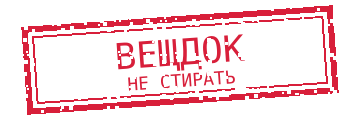

> **ДЕТЕКТИВ.** На кассете — рабочая графическая среда для **NixOS**. [Niri](https://github.com/YaLTeR/niri) двигает окна, [Quickshell](https://quickshell.org) рисует панель и виджеты. Это не отдельный дистрибутив: YozekOS — интерфейс, конфигурации и инструменты, собранные [Yozekkk](https://github.com/Yozekkk). Плёнка стилизована под старую запись; снимки интерфейса ниже сделаны в работающем YozekOS.


<sub>▶ <b>КАДР 00</b> · рабочий стол YozekOS · реальные снимки сделаны в Niri, отладочные кадры с личными окнами не публикуются</sub>

> [!NOTE]
> На странице показаны состояния работающей оболочки. Отдельные настройки, например Dynamic Island, включались для демонстрации; профиль поставки повторяет текущий профиль автора. В таблицах `Mod` означает **Super / Windows**. Кассеты, даты и «дело» — художественное оформление, не журнал событий.

<div align="center">

**ОПИСЬ**

| | | | | |
| :-: | --- | --- | :-: | --- |
| [01](#tape-01) | *записка* · установка | | [07](#tape-07) | *остров панели* · Dynamic Island |
| [02](#tape-02) | *две темы* · свет и тень | | [08](#tape-08) | *снимок экрана* · захват |
| [03](#tape-03) | *обои и цвета* | | [09](#tape-09) | *чужой код* · авторство |
| [04](#tape-04) | *меню и виджеты* | | [10](#tape-10) | *обновление* · диагностика |
| [05](#tape-05) | *всё можно поменять* · настройки | | [11](#tape-11) | *на чём работает* · технологии |
| [06](#tape-06) | *окна на ленте* · Niri | | [12](#tape-12) | *сохрани среду* · репозиторий |
| | | | [▤](#tape-keys) | *приклеено под клавиатурой* · клавиши |

</div>


<a id="tape-01"></a>

> **▶ ЗАПИСЬ** · 20.12.2002 23:41\
> на полях четыре строки. первая ведёт к исходникам.\
> третья показывает, что случится. четвёртая ждёт твоего согласия.

**◉ СЕЙЧАС**\
YozekOS устанавливает пользовательские файлы отдельно от системных пакетов. Сначала просмотрите план. Если путь уже занят, установщик сохранит его копию и спросит разрешение на замену.

<div align="center">
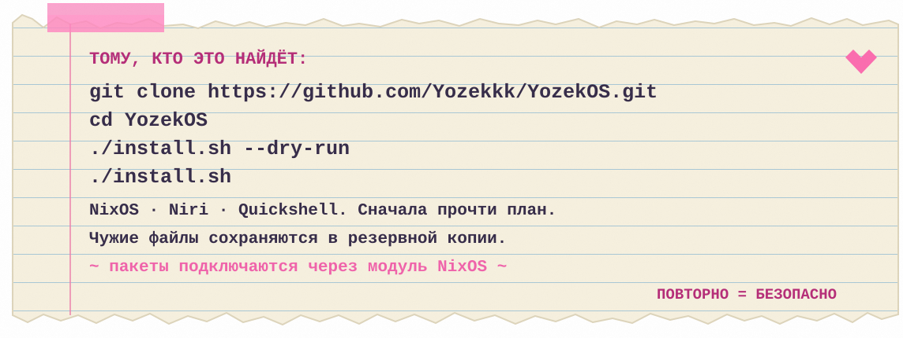
</div>

```bash
git clone https://github.com/Yozekkk/YozekOS.git
cd YozekOS
./install.sh --dry-run
./install.sh
```

<details>
<summary>✉ <b>опись к кассете 1</b> · установка</summary>

<br>

Проверенная база — NixOS 26.05, Niri 26.04 и Quickshell 0.3.x. Для системных зависимостей подключите [`nix/module.nix`](nix/module.nix) к своей NixOS-конфигурации по [подробной инструкции](docs/installation.md). Модуль не выполняет `nixos-rebuild`, не выбирает за вас сеанс входа и по умолчанию не включает тему SDDM. Home Manager можно использовать для эквивалентного набора пользовательских пакетов.

`./install.sh --dry-run` ничего не записывает. Обычная установка создаёт ссылки на исходники и копирует переносимую конфигурацию Niri; при конфликте делает резервную копию в `~/.local/state/yozekos/installer/backups/`. Повторный запуск не меняет совпадающие файлы. После входа в Niri запустите `systemctl --user start yozekos-shell.service`; далее Niri запускает сервис сам. Удаление: `./install.sh --uninstall --dry-run`, затем `./install.sh --uninstall`.

</details>


<a id="tape-02"></a>

> **▶ ЗАПИСЬ** · 21.12.2002 14:05\
> один и тот же стол. свет повернули — у букв поменялась тень.\
> значок «Пуск» остался на месте.

**◉ СЕЙЧАС**\
Пиксельный характер задают CozetteVector и Pixeloid. Цвета, темы, шрифты, прозрачность и эффекты меняются в окне настроек. Панель остаётся знакомой: «Пуск», пространства, окна и системные индикаторы.

 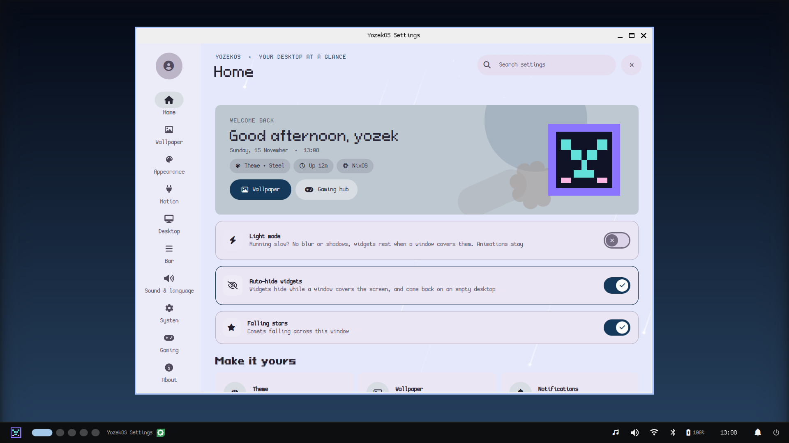

<details>
<summary>✉ <b>опись к кассете 2</b> · оформление</summary>

<br>

В «Оформлении» выбираются темы и палитра. [Руководство по настройке](docs/configuration.md) связывает каждый видимый переключатель с файлами `~/.config/yozekos/`. Начальные значения находятся в [`yozekos/defaults/`](yozekos/defaults/); существующие личные JSON установщик сохраняет. Значок «Пуск» можно заменить собственным изображением в настройках панели. Курсоры и шрифты поставляются с указанием их исходных лицензий.

</details>


<a id="tape-03"></a>

> **▶ ЗАПИСЬ** · 22.12.2002 02:17\
> фон меняется; панель подхватывает цвет.\
> плёнка ничего не говорит о том, откуда взялась картинка.

**◉ СЕЙЧАС**\
При первом запуске YozekOS регистрирует встроенный набор обоев. Если фон ещё не выбран, появляется `wide.jpg`. Свои изображения остаются в домашнем каталоге и не попадают в Git. Большие коллекции PixelStreetArt скачиваются отдельно, по желанию владельца.

<div align="center">
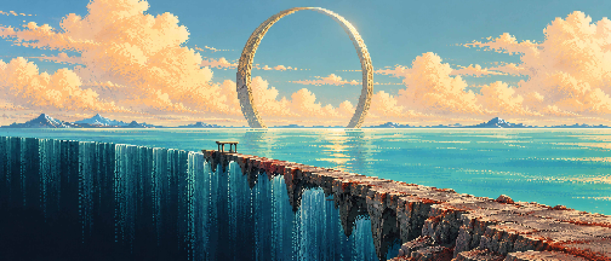
</div>

<details>
<summary>✉ <b>опись к кассете 3</b> · обои</summary>

<br>

Галерея и переходы настраиваются через **Super+W** или `yozekos wallpaper`. Команда `rice-walls` хранит выбранный фон и управляет `awww`; для видеообоев дополнительно нужны `mpvpaper` и `ffmpeg`. Внешние коллекции может загрузить `python3 scripts/install-wallpapers.py install --packs Pixel`. У изображений могут быть отдельные условия использования, поэтому весь сторонний архив в репозиторий не включён.

</details>


<a id="tape-04"></a>


> **▶ ЗАПИСЬ** · 22.12.2002 19:30\
> нажала на маленький квадрат слева. внутри — все программы.\
> окно ищет быстрее, чем успеваешь допечатать.

**◉ СЕЙЧАС**\
Меню приложений открывается по **Super+R** или **Super+Space**. Панель показывает открытые окна Niri, рабочие пространства, трей, звук, сеть, Bluetooth, уведомления и часы. Виджеты рабочего стола и состав панели выбираются в настройках.


<details>
<summary>✉ <b>опись к кассете 4</b> · меню и виджеты</summary>

<br>

Главная точка входа Quickshell — [`yozekos/quickshell/rice-desktop/shell.qml`](yozekos/quickshell/rice-desktop/shell.qml). Рядом находятся `Launcher.qml`, `Bar.qml`, `NotifServer.qml`, `ControlCenter.qml` и файлы виджетов. Положение виджетов хранится в `desktop.json`, раскладка панели — в `bar.json`. Список компонентов и связей приведён в [архитектуре](docs/architecture.md).

</details>


<a id="tape-05"></a>


> **▶ ЗАПИСЬ** · 23.12.2002 11:52\
> ручка застряла на слове «настройки».\
> под ним ещё три: шрифт, панель, клавиши.

**◉ СЕЙЧАС**\
**Super+U** открывает YozekOS Settings. Панель, значок «Пуск», Dynamic Island, обои, темы, виджеты, эффекты, курсор и параметры Niri доступны через интерфейс. Редактирование Niri проверяется установленным валидатором до применения.


<details>
<summary>✉ <b>опись к кассете 5</b> · что настраивается</summary>

<br>

Пользовательские файлы лежат в `~/.config/yozekos/`. Путь `~/.config/rice` оставлен как ссылка для совместимости с унаследованными скриптами. Клавиши и правила окон находятся в `~/.config/niri/config.kdl`; переносимый образец — [`yozekos/config/niri/config.kdl`](yozekos/config/niri/config.kdl). После ручной правки используйте `niri validate -c ~/.config/niri/config.kdl`. О назначении JSON-файлов и параметров — в [руководстве](docs/configuration.md).

</details>


<a id="tape-06"></a>

> **▶ ЗАПИСЬ** · 24.12.2002 21:08\
> окна не лежат стопкой. лента уходит вбок.\
> нажала O — весь стол отступил и показал остальные.

**◉ СЕЙЧАС**\
Niri отвечает за прокручиваемую раскладку, анимации, жесты, правила окон и пространства. **Super+O** и **Super+Tab** открывают его встроенный обзор; **Super+1…9** выбирают рабочее пространство. На панели каждый открытый объект может отображаться отдельной иконкой или группой.


<details>
<summary>✉ <b>опись к кассете 6</b> · Niri, терминал, клавиши</summary>

<br>

Рабочая конфигурация Niri включена в репозиторий вместе с горячими клавишами и правилами. Машинные настройки мониторов не переносятся: после установки определите имена выходов через `niri msg outputs`. **Super+Q** открывает Kitty, **Super+E** — файловый менеджер. Конфигурация Kitty, Starship и пиксельные шрифты также включены. [Полная таблица сочетаний](docs/keybindings.md) построена по актуальному KDL.

</details>

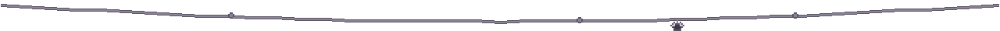

<a id="tape-07"></a>

> **▶ ЗАПИСЬ** · 25.12.2002 16:44\
> часы отделились от края панели и оказались в центре.\
> переключатель щёлкнул ещё раз — вернулись обратно.

**◉ СЕЙЧАС**\
Dynamic Island — отдельный модуль панели. Его переключатель в YozekOS Settings добавляет модуль и убирает его, не двигая правые часы произвольно. На кадре он **включён для проверки**; в исходном профиле автора выключен.

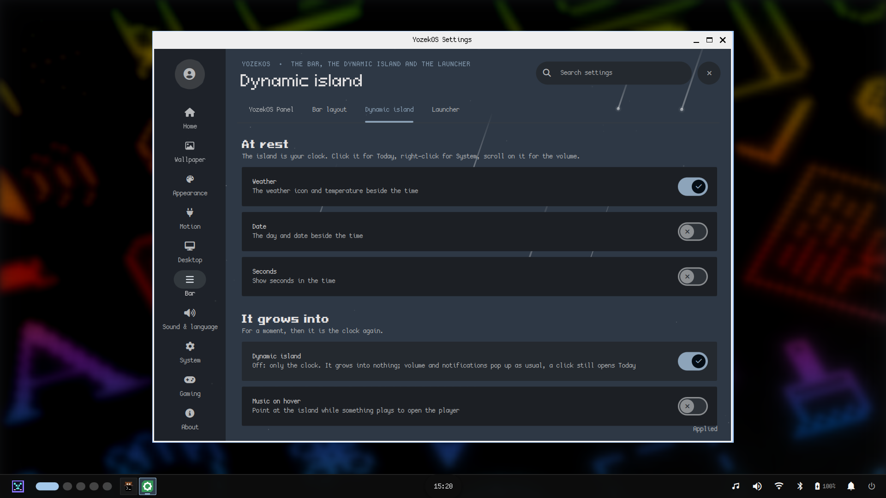

<details>
<summary>✉ <b>опись к кассете 7</b> · Dynamic Island и управление</summary>

<br>

Раздел панели позволяет выбрать расположение модулей, размер значка «Пуск», способ группировки окон и поведение острова. Громкость, медиа, сеть, Bluetooth и уведомления используют соответствующие службы NixOS и устройства; без них связанные кнопки имеют ограниченные функции. Звук в интерфейсе зависит от PipeWire, сеть — от NetworkManager, Bluetooth — от BlueZ.

</details>


<a id="tape-08"></a>

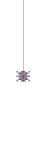

> **▶ ЗАПИСЬ** · 26.12.2002 03:33\
> рамка задержалась на одном фрагменте экрана.\
> всё остальное осталось за пределами кадра.

**◉ СЕЙЧАС**\
**Print** или **Super+Shift+S** запускают выбор области. Есть сохранение, копирование в буфер, предпросмотр и открытие редактора Satty. **Super+Shift+R** вызывает запись области через отдельный скрипт. Скриншот селектора с чужим содержимым рабочего окна здесь не публикуется.

<details>
<summary>✉ <b>опись к кассете 8</b> · захват и запись</summary>

<br>

Исходники выбора области и предпросмотра находятся в [`yozekos/capture/`](yozekos/capture/) и `ShotPreview.qml`. Для снимков нужны `grim`, `wl-copy`, GTK layer-shell и по желанию Satty; для записи — `wf-recorder` и `ffmpeg`. Настройки формата и частоты кадров доступны в интерфейсе и через `yozekos-capture-settings`. Ограничения проверок перечислены в [отчёте](docs/verification.md).

</details>


<a id="tape-09"></a>

> **▶ ЗАПИСЬ** · 27.12.2002 20:20\
> на коробке три почерка.\
> если отклеить чужие подписи, запись станет нечестной.

**◉ СЕЙЧАС**\
YozekOS собирает собственную среду из открытых компонентов. Значительная часть архитектуры Quickshell и скриптов происходит от DarkShadowShell; пиксельные элементы, селектор снимков и тема входа связаны с AngelOS. У каждого автора остаются его лицензия и признание.

<details>
<summary>✉ <b>опись к кассете 9</b> · источники и лицензии</summary>

<br>

[DarkShadowShell](https://github.com/shadowww-dev/DarkShadowShell), [AngelOS-Dotfiles](https://github.com/MixaDoDs/AngelOS-Dotfiles), [Niri](https://github.com/YaLTeR/niri) и [Quickshell](https://quickshell.org) названы прямо. SVG-оформление этой страницы адаптировано из README AngelOS-Dotfiles под MIT; исходный автор — MixaDoDs. Лицензии шрифтов, курсоров и иных ресурсов сведены в [`THIRD-PARTY.md`](THIRD-PARTY.md). Большие коллекции сторонних обоев в Git не включены.

</details>


<a id="tape-10"></a>


> **▶ ЗАПИСЬ** · 28.12.2002 09:15\
> следующая копия плёнки не должна стирать предыдущую.\
> пусть сначала покажет, что поменяется.

**◉ СЕЙЧАС**\
Исходники обновляются через Git. Перед повторной установкой снова посмотрите план. Пользовательские конфигурации не удаляются молча; установщик ведёт манифест собственных файлов и резервные копии заменённых путей.

```bash
git pull --ff-only
./install.sh --dry-run
./install.sh
yozekos restart
```

<details>
<summary>✉ <b>опись к кассете 10</b> · обновление и диагностика</summary>

<br>

`yozekos doctor` проверяет сеанс, сервис и шрифты. Журнал панели: `journalctl --user -u yozekos-shell.service -b -n 80`. При сбоях используйте [диагностику](docs/troubleshooting.md). Установщик не перезапускает Niri и не выполняет системный rebuild. Обновление модульных пакетов NixOS остаётся частью вашего обычного процесса управления системой.

</details>


<a id="tape-11"></a>

> **▶ ЗАПИСЬ** · 30.12.2002 22:47\
> у плёнки есть формат. у машины — зависимости.\
> если забыть хотя бы одну, изображение не появится.

**◉ СЕЙЧАС**\
NixOS предоставляет пакеты и системные службы. Niri управляет окнами. Quickshell и QML собирают интерфейс; Python и shell-скрипты связывают настройки, обои и захват экрана. На текущем компьютере проверялись NixOS 26.05, Niri 26.04 и Quickshell 0.3.x.

<details>
<summary>✉ <b>опись к кассете 11</b> · архитектура и требования</summary>

<br>

| Слой | Назначение |
| --- | --- |
| Niri | Раскладка, обзор пространств, жесты, правила и сочетания клавиш |
| Quickshell / Qt Quick | Панель, меню, центр управления, уведомления, виджеты и настройки |
| PipeWire / playerctl | Звук и медиа |
| NetworkManager / BlueZ | Сеть и Bluetooth при наличии служб |
| awww / Matugen | Обои и цвета |
| Python / GTK / Satty | Установка, выбор области и редактирование снимков |

Каталоги и точки входа разобраны в [документе об архитектуре](docs/architecture.md). Точный список пакетов и порядок подключения NixOS-модуля — в [установке](docs/installation.md).

</details>


<a id="tape-12"></a>


> **▶ ЗАПИСЬ** · 31.12.2002 23:58\
> последняя кассета показывает не экран, а список файлов.\
> если он цел, стол можно собрать снова.

<p align="center"><code>23:59:59 ░░░░░░░░░░░░░░░░ НЕТ СИГНАЛА</code></p>

**◉ СЕЙЧАС**\
[Исходный код YozekOS](https://github.com/Yozekkk/YozekOS) опубликован вместе с конфигурацией Niri, исходниками Quickshell, скриптами, шрифтами и документацией. Автор проекта — [Yozekkk](https://github.com/Yozekkk). README показывает реальные проверенные кадры; кэши, личные файлы и снимки рабочих окон в проект не перенесены.

<details>
<summary>✉ <b>опись к кассете 12</b> · структура, лицензия, проверки</summary>

<br>

```text
nix/                         модуль и пакеты NixOS
scripts/                     установка и коллекции обоев
yozekos/config/niri/         переносимая конфигурация Niri
yozekos/defaults/             исходный профиль интерфейса
yozekos/quickshell/          QML оболочки и настроек
yozekos/bin/                 команды и сервисы
yozekos/capture/             выбор области и предпросмотр
fonts/                       шрифты и лицензии
docs/                        руководства и проверенные кадры
```

Собственные части проекта — [MIT](LICENSE); чужие части сохраняют условия исходных авторов. [Полная ведомость](THIRD-PARTY.md), [проверки](docs/verification.md) и [репозиторий](https://github.com/Yozekkk/YozekOS) доступны без отдельного установщика.

</details>


<a id="tape-keys"></a>

<details>
<summary><b>▤ ЛИСТОК 1</b> · оболочка</summary>

<br>

| Клавиши | Действие |
| --- | --- |
| Super+R / Super+Space | Меню приложений |
| Super+U | Настройки YozekOS |
| Super+E | Файловый менеджер |
| Super+Q | Kitty |
| Super+N | Центр уведомлений |
| Super+W | Галерея обоев |

</details>

<details>
<summary><b>▤ ЛИСТОК 2</b> · окна и пространства</summary>

<br>

| Клавиши | Действие |
| --- | --- |
| Super+O / Super+Tab | Обзор Niri |
| Super+1…9 | Перейти в пространство |
| Super+Shift+Q | Закрыть окно |
| Super+← / → | Фокус на соседний столбец |
| Super+F | Полный экран |

</details>

<details>
<summary><b>▤ ЛИСТОК 3</b> · снимки и управление</summary>

<br>

| Клавиши | Действие |
| --- | --- |
| Print / Super+Shift+S | Выбор области для снимка |
| Ctrl+Shift+2 | Снимок экрана |
| Ctrl+Shift+3 | Снимок окна |
| Super+Shift+R | Запись области |
| Клавиши XF86Audio и XF86MonBrightness | Звук и яркость |

</details>

<details>
<summary><b>▤ ЛИСТОК 4</b> · если плёнка заела</summary>

<br>

Полная таблица сочетаний составлена по текущему Niri KDL: [docs/keybindings.md](docs/keybindings.md). Проверьте конфигурацию через `niri validate -c ~/.config/niri/config.kdl`, а панель — через `yozekos doctor`. Сеанс Niri не нужно завершать ради чтения этих команд.

</details>


<div align="center">

*Кассета найдена. Исходники сохранены.* · [YozekOS](https://github.com/Yozekkk/YozekOS) · [Авторство](THIRD-PARTY.md)

</div>
